<p align="center">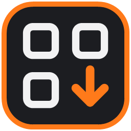</p>

<h1 align="center">SLT Drop Local QRCode</h1>

<p align="center">
  <b>Mande fotos, vídeos e qualquer arquivo do celular para o PC pela rede Wi-Fi — sem cabo, sem internet e sem instalar nada no celular.</b>
</p>

<p align="center">
  <a href="https://github.com/mikerock12/slt-drop-local-qrcode/releases/latest"></a>
  <a href="https://github.com/mikerock12/slt-drop-local-qrcode/actions/workflows/ci.yml"></a>
  
  
  
</p>

<p align="center">
  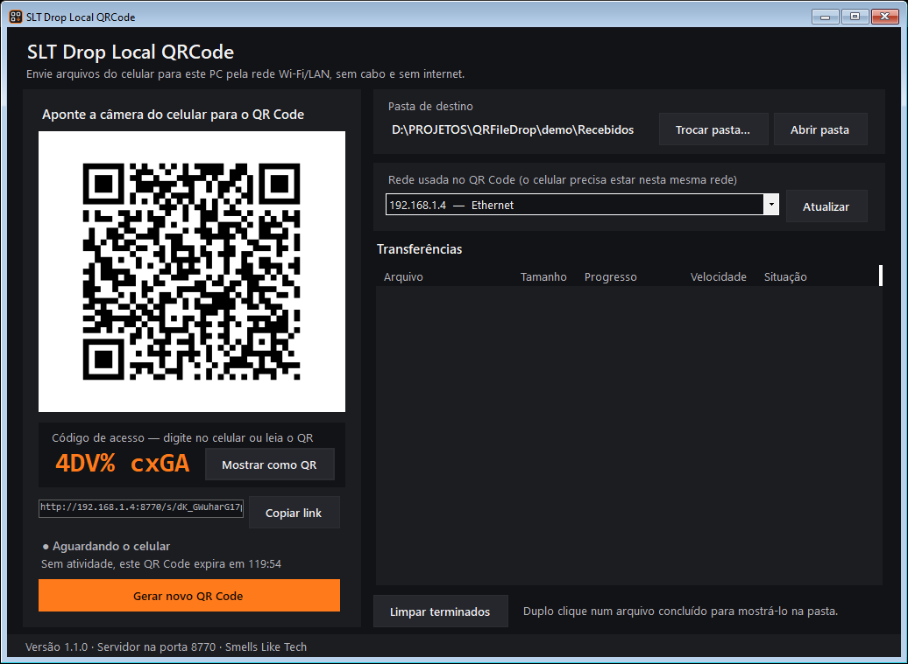
  &nbsp;
  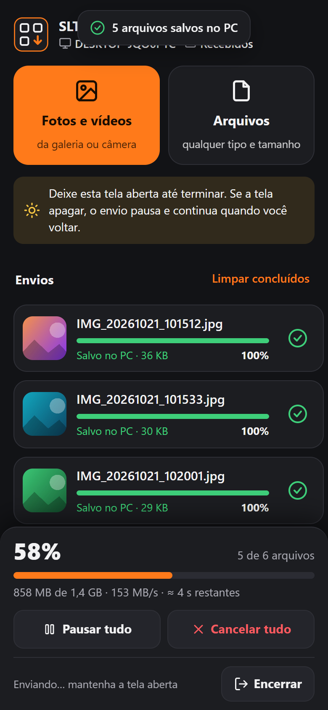
</p>

---

## Por que usar

- **Nada para instalar no celular.** O QR Code abre uma página no navegador (Chrome, Safari, Samsung Internet…). Funciona em Android e iPhone.
- **Sem limite de tamanho.** Vídeos de vários gigabytes vão em blocos de 8 MB gravados direto no disco do PC. Testado com arquivo acima de 4 GB.
- **Você vê tudo:** porcentagem, velocidade e tempo restante por arquivo e no total, no celular e no PC.
- **Pausar, retomar e cancelar** cada arquivo ou todos. Se o Wi-Fi oscilar, o envio reconecta e continua de onde parou.
- **Não passa pela internet.** O arquivo vai direto do celular para o PC, pela sua rede.
- **Seguro por padrão:** QR Code de uso único, código de acesso de 8 caracteres, uma sessão por aparelho e expiração automática.

## Como funciona

| 1. Abra o programa no PC | 2. Escaneie e digite o código | 3. Escolha os arquivos |
|:---:|:---:|:---:|
|  | 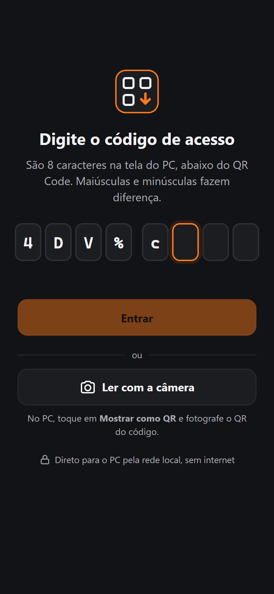 | 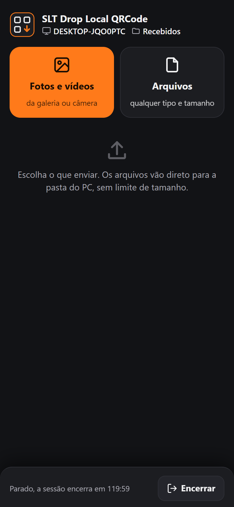 |
| Escolha a pasta onde os arquivos vão ficar. Aparecem o **QR Code** e o **código de acesso**. | A câmera do celular abre a página. Digite os 8 caracteres do código, ou toque em **Ler com a câmera**. | **Fotos e vídeos** abre a galeria; **Arquivos** aceita qualquer tipo. Escolha vários de uma vez. |

| 4. Acompanhe o envio | 5. Pause quando quiser | 6. Pronto |
|:---:|:---:|:---:|
|  | 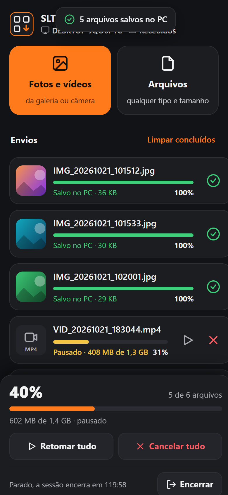 | 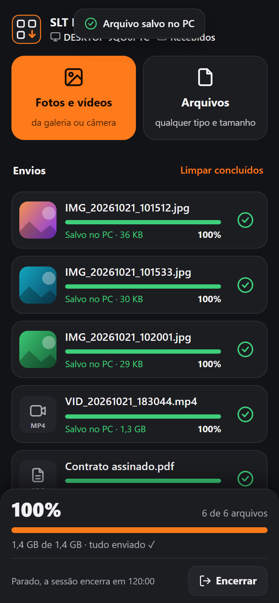 |
| Porcentagem, velocidade e tempo restante. O painel de baixo mostra o total. | Pausar um arquivo deixa a fila seguir com os outros. Retome quando quiser. | Os arquivos já estão na pasta do PC. Toque em **Encerrar** para fechar a sessão. |

No PC, a lista de transferências mostra cada arquivo chegando:

<p align="center">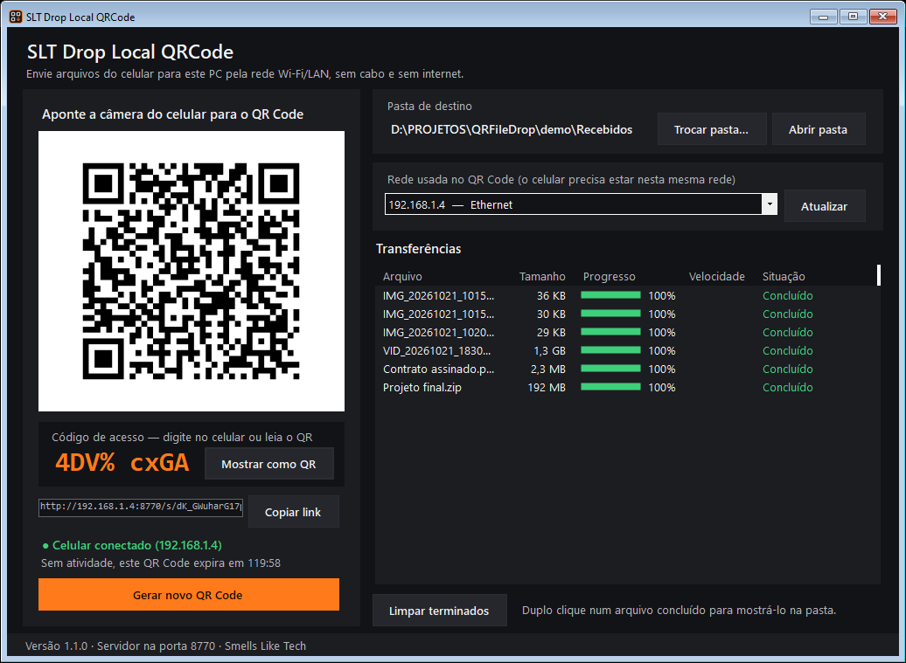</p>

### Sem digitar o código: leia pela câmera

Digitar `Ws+e d4BT` no celular dá trabalho. No PC, clique em **Mostrar como QR**: o QR passa a ter só o código (moldura laranja). No celular, toque em **Ler com a câmera** e fotografe a tela do PC. A página lê o código da foto e entra sozinha.

<p align="center">
  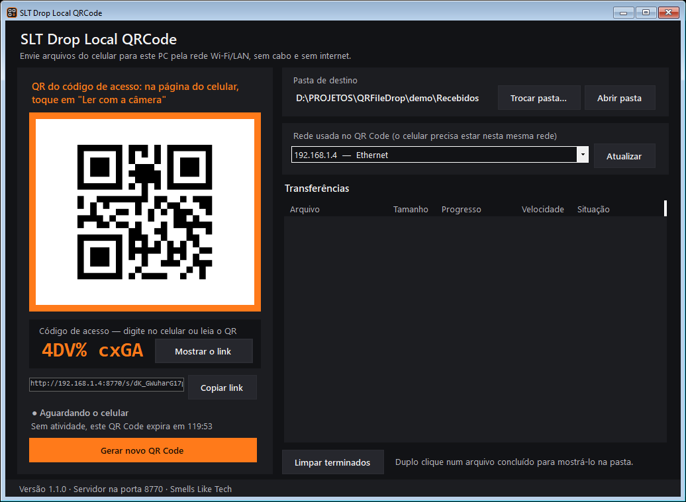
</p>

> A página usa a câmera nativa do celular (tira uma foto) em vez de vídeo ao vivo porque os navegadores só liberam câmera ao vivo em sites HTTPS, e a conexão com o PC é HTTP na rede local. A leitura do QR acontece no próprio celular, sem internet.

## Exemplos de uso

- **Fotos e vídeos da viagem para o PC:** toque em *Fotos e vídeos*, selecione o álbum inteiro e deixe o celular na mesa. Repetidos não sobrescrevem: o segundo `IMG_0001.jpg` vira `IMG_0001 (2).jpg`.
- **Vídeo 4K de 20 GB:** escolha o vídeo e acompanhe o tempo restante. Se precisar sair, toque em pausar; na volta, retome do mesmo ponto (sem recomeçar), desde que seja antes de a sessão expirar.
- **Balcão de atendimento / assistência técnica:** o cliente escaneia o QR, digita o código que só aparece no seu monitor e manda os documentos ou fotos do aparelho para a pasta do atendimento. Ao terminar, **Encerrar** invalida o link na hora.
- **Arquivos do trabalho (PDF, ZIP, planilhas):** use *Arquivos*; qualquer extensão é aceita.
- **PC com várias placas de rede (cabo, Wi-Fi, VPN, máquinas virtuais):** escolha em *Rede usada no QR Code* a placa ligada ao mesmo roteador do celular.

Para automatizar (atalho na área de trabalho, script), o programa aceita parâmetros:

```powershell
# Abre direto numa pasta, sem perguntar
& "C:\Program Files\SLT Drop Local QRCode\SLTDropLocalQRCode.exe" --pasta "D:\Recebidos"

# Porta fixa e sessão que expira após 5 minutos parada
& "C:\Program Files\SLT Drop Local QRCode\SLTDropLocalQRCode.exe" --pasta "D:\Recebidos" --porta 9000 --inatividade-segundos 300
```

| Opção | Efeito |
|---|---|
| `--pasta "D:\Recebidos"` | Usa a pasta sem abrir a janela de escolha |
| `--porta 8770` | Porta preferida (padrão 8770; se estiver ocupada, tenta as 19 seguintes e depois qualquer livre) |
| `--inatividade-segundos 900` | Tempo parado até a sessão expirar (padrão 15 minutos) |

## Segurança

Cada sessão tem **duas chaves**, e o celular precisa das duas:

1. **O link do QR Code**, com um token aleatório de 256 bits. Sem ele não há página nem API.
2. **O código de acesso de 8 caracteres**, que só aparece escrito na tela do PC. Mistura maiúsculas, minúsculas, números e símbolos (cerca de 47 bits) e deixa de fora os caracteres que se confundem (`I l 1 O o 0`). Nenhum código se repete: o programa guarda o histórico dos já usados.

Além disso:

- **5 tentativas.** Errar o código 5 vezes encerra a sessão; o PC gera QR e código novos e o link antigo para de funcionar.
- **Um aparelho por sessão.** Quem acerta o código primeiro fica com a sessão; outro aparelho é recusado mesmo sabendo o código.
- **Chave em cookie HttpOnly**, restrito ao caminho da sessão e com `SameSite=Strict`: o JavaScript da página nunca a vê.
- **Uso único.** A sessão termina pelo botão **Encerrar** no celular, por **Gerar novo QR Code** no PC ou após **15 minutos sem atividade**. Um link encerrado nunca volta a funcionar (responde *410 Gone*).
- **Nada pela metade fica no PC:** envios incompletos de uma sessão encerrada são apagados.
- **Nomes seguros:** `../`, nomes reservados do Windows (`CON`, `NUL`…) e caracteres inválidos são corrigidos; nada é gravado fora da pasta escolhida.
- **Firewall:** o instalador cria uma regra de entrada só para o programa (removida na desinstalação). O tráfego fica na rede local.

<p align="center">
  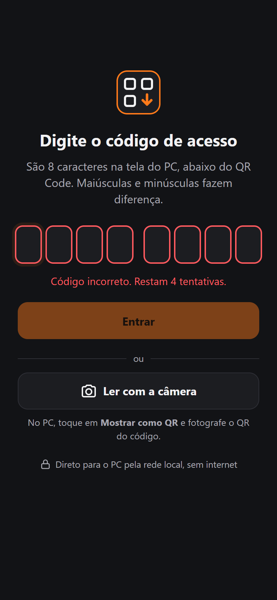
  &nbsp;
  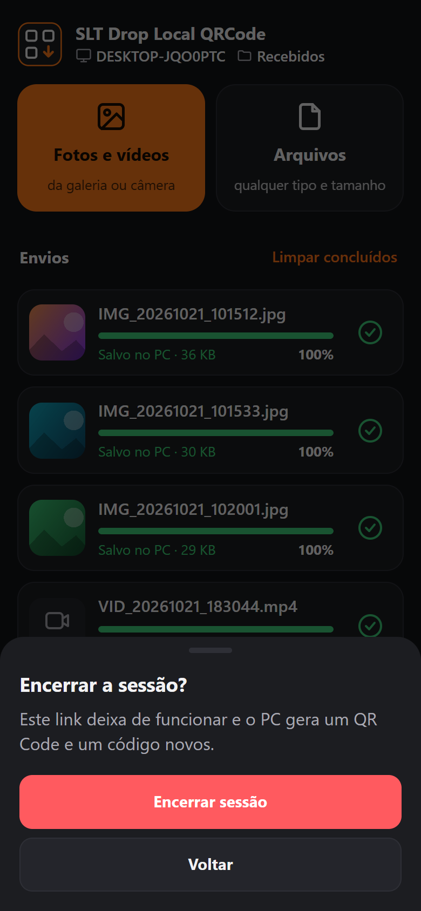
  &nbsp;
  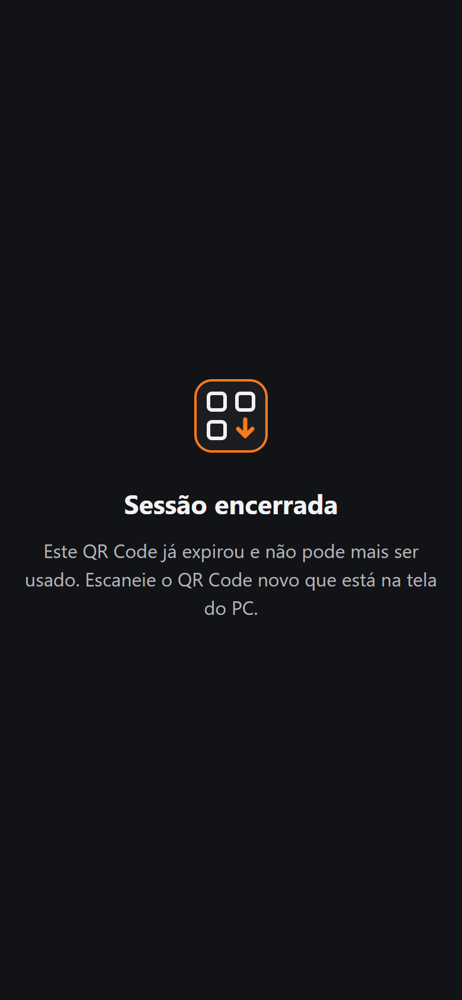
  &nbsp;
  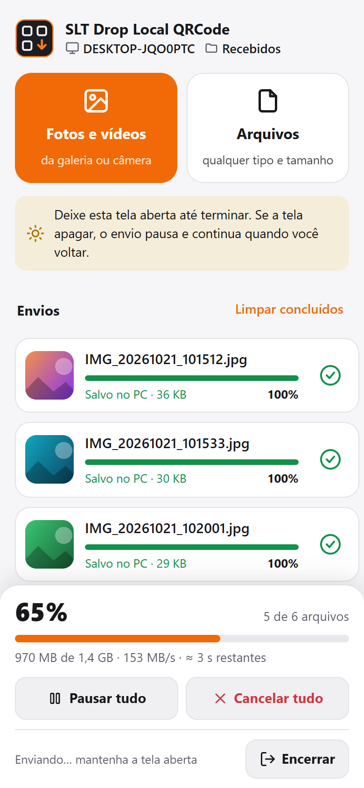
</p>

<p align="center"><sub>Código errado · confirmação para encerrar · link antigo recusado · tema claro automático (para usar no sol)</sub></p>

## Instalação

1. Baixe `SLT-Drop-Local-QRCode-Setup-<versão>.exe` na [página de versões](https://github.com/mikerock12/slt-drop-local-qrcode/releases/latest).
2. Execute e confirme como administrador. É a permissão que deixa o instalador criar a regra do Firewall do Windows.
3. Abra pelo Menu Iniciar → **SLT Drop Local QRCode**.

O instalador já traz tudo (runtime do .NET, Windows Forms, servidor HTTP e gerador de QR Code). Requisitos: Windows 10 ou 11, 64 bits. Como o instalador ainda não tem assinatura digital, o Windows pode mostrar o aviso do SmartScreen: clique em *Mais informações → Executar assim mesmo*.

## Se o celular não abrir o link

- Confira se os dois estão **na mesma rede**. Redes de *convidados* costumam isolar os aparelhos entre si.
- **Desligue os dados móveis** do celular e tente de novo.
- No PC, em **Rede usada no QR Code**, escolha a placa ligada ao roteador do celular.
- Se usar outro antivírus/firewall além do Windows Defender, libere o programa nele.

## Desenvolvimento

Requisitos: .NET SDK 10 e Inno Setup 6 (`winget install --id JRSoftware.InnoSetup`).

```powershell
dotnet test SltDropLocal.slnx                # testes
.\scripts\gerar-instalador.ps1               # testes + publicação + instalador em entrega\
```

O teste com arquivo acima de 4 GB é lento e só roda com `SLTDROP_TESTE_GRANDE=1`. O CI (GitHub Actions, Windows) roda os testes e gera o instalador como artefato a cada PR.

| Pasta | Conteúdo |
|---|---|
| `src/SltDropLocal.Core` | Sessões e código de acesso, recebimento em blocos, servidor HTTP (Kestrel), página do celular, QR Code |
| `src/SltDropLocal.App` | Programa Windows Forms |
| `tests/SltDropLocal.Tests` | Testes de unidade e de integração com servidor HTTP real |
| `instalador/` | Script do Inno Setup e LEIA-ME instalado junto |
| `scripts/` | Geração do instalador e do ícone |

A versão fica em `Directory.Build.props`; o instalador e o rodapé do programa leem de lá.

### API usada pela página do celular

Tudo fica sob `/s/{token}`. A página abre só com o token; a API exige antes o código de acesso.

| Método | Caminho | Uso |
|---|---|---|
| `GET` | `/s/{t}` | Página de envio (pede o código) |
| `POST` | `/s/{t}/api/acesso` | Confere o código `{codigo}`; devolve a chave em cookie. 5 erros encerram a sessão |
| `GET` | `/s/{t}/api/estado` | Tempo até expirar, nome do PC, pasta, tamanho do bloco (não conta como atividade) |
| `POST` | `/s/{t}/api/envios` | Começa um arquivo `{nome, tamanho}` |
| `GET` | `/s/{t}/api/envios/{id}` | De onde continuar |
| `PUT` | `/s/{t}/api/envios/{id}?posicao=N` | Um bloco de bytes |
| `POST` | `/s/{t}/api/envios/{id}/pausa` | Avisa o PC da pausa |
| `DELETE` | `/s/{t}/api/envios/{id}` | Cancela e apaga o que chegou |
| `POST` | `/s/{t}/api/encerrar` | Encerra a sessão |
| `GET` | `/recursos/jsqr.js` | Leitor de QR usado pelo botão *Ler com a câmera* (público, sem dados da sessão) |

Respostas de erro: sem código `401`, sessão expirada `410`, link inexistente `404`, sessão de outro aparelho `403`.

## Componentes de terceiros

QRCoder (MIT), jsQR (Apache-2.0) e .NET (MIT). Detalhes em [THIRD-PARTY-NOTICES.md](THIRD-PARTY-NOTICES.md).

---

<p align="center">Feito pela <b>Smells Like Tech</b></p>


## Portal SLT

[Recursos, demonstração e download atualizado](https://softwares.smellsliketech.com.br/apps/drop-local/). Cada merge em main publica automaticamente o instalador validado pelo CI. Este app também integra o workspace central SoftwaresSLT.
